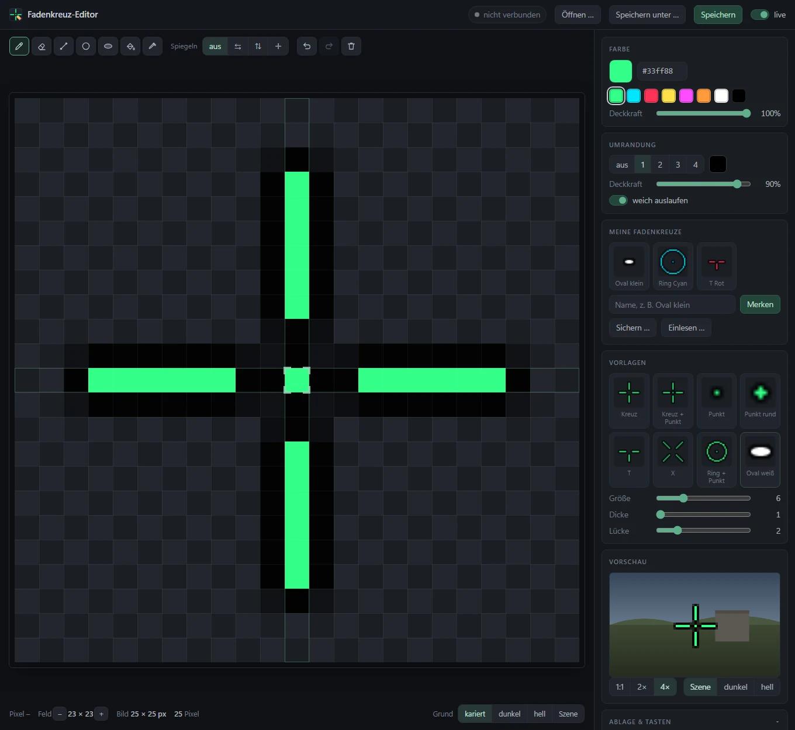
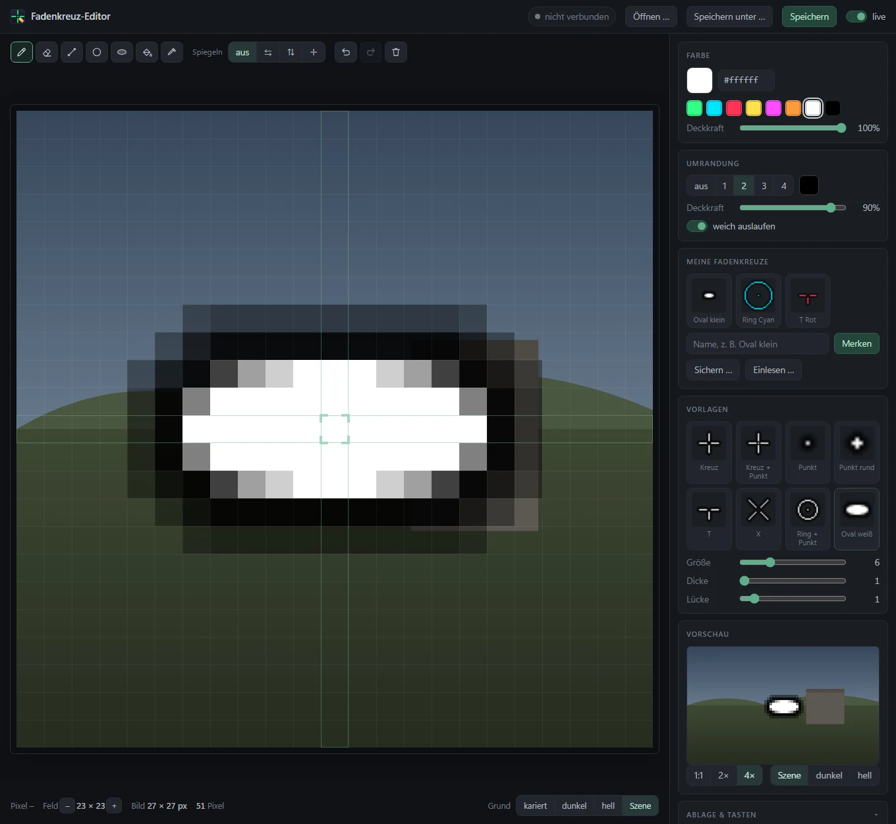

# Fadenkreuz 🎯

**Your own crosshair in the exact centre of the screen – drawn by you, running on about 1 MB of RAM.** A tiny Windows overlay that sits on top of your game, lets every click pass through, and shows whatever you drew in its editor. Neon green on black by default.

   

[Deutsche Fassung](README.de.md) — the app itself speaks German.



---

## What for

Some games have no crosshair, a poor one, or hide it while you shoot from the hip. Fadenkreuz puts your own on top: exactly in the middle of the main screen, always in front, and clicks go straight through to the game.

Tools like Crosshair X do the same through the Xbox Game Bar – which works well, but the Game Bar itself takes a lot of memory, and while gaming there is often none to spare. Fadenkreuz is a 55 KB native program without any runtime. Running, it needs about 1 MB, of which only around 0.2 MB is its own; the rest are Windows libraries that every program shares.

## Two parts, installed separately

| | |
|---|---|
| **Fadenkreuz** – the overlay | written in C, no frameworks. Reads `Documents\Fadenkreuz\fadenkreuz.bmp` and picks up every change within a second. |
| **Editor** – for drawing | a single page that opens as its own slim Edge window. It only uses memory while it is open. |

In the installer you choose both or just one of them. They do not depend on each other: the overlay runs without the editor, and the editor draws without the overlay running.

## Getting started

1. Download **`Fadenkreuz-Setup-1.0.0.exe`** from the [releases](../../releases/latest). Windows will say "unknown publisher" – the setup is not signed, because that costs money. Continue via **More info → Run anyway**.
2. Choose **Install for me only** (no admin rights needed) or **Install for all users**, then the parts you want.
3. Start **Fadenkreuz**: a green cross appears in the middle of the screen.
4. Open **Fadenkreuz-Editor**, draw, click **Speichern unter …** (*Save as*) once and save as `fadenkreuz.bmp` in `Documents\Fadenkreuz`. The editor remembers the file; with **live** switched on, every stroke shows up on screen within a second.

## Keys

| | |
|---|---|
| <kbd>Ctrl</kbd>+<kbd>Alt</kbd>+<kbd>F9</kbd> | hide / show the crosshair |
| <kbd>Ctrl</kbd>+<kbd>Alt</kbd>+<kbd>F10</kbd> | press it **inside a game**: from now on the crosshair only appears while that game is in front. Press again to remove the game. |
| <kbd>Ctrl</kbd>+<kbd>Alt</kbd>+<kbd>F12</kbd> | quit – or simply start Fadenkreuz a second time |

## The editor



- **Tools:** pencil, eraser, line, ring, filled oval, fill and colour picker; the right mouse button always erases.
- **Mirroring** left/right, top/bottom or four ways – a symmetrical crosshair in a few strokes.
- **Outline** 0 to 4 pixels in any colour and opacity, optionally fading out softly.
- **Templates:** cross, cross + dot, dot, round dot, T, X, ring + dot and **Oval weiß** – a white oval with smoothed edges and a soft black outline. Size, thickness and gap are adjustable.
- **My crosshairs:** save your own designs under a name, load them with one click, and back them all up to a file (or read them back in, e.g. on another PC).
- **Preview** at true size (1:1), 2× or 4× against a game-like scene, dark or light.
- Undo and redo, adjustable field size, a pixel-exact grid that marks the centre.

Edge and Chrome save straight into the file. Firefox cannot do that and downloads the image instead.

## Only in certain games

Press <kbd>Ctrl</kbd>+<kbd>Alt</kbd>+<kbd>F10</kbd> while a game is in front, and Fadenkreuz writes it to `Documents\Fadenkreuz\programme.txt`. As long as that list has entries, the crosshair only shows while one of those programs is in front – switch to the desktop and it disappears. An empty list means: always visible. You can also edit the file by hand, one `.exe` name per line.

## On top of everything (optional)

Normally the crosshair is an "always on top" window: above your game, but below the Start menu, taskbar pop-ups and some overlays. If you choose **Install for all users**, the installer offers **Show on top of everything**.

Windows only allows that (it is called *UIAccess*, the same as for the on-screen keyboard) for signed programs inside *Program Files*. So the setup creates a certificate that is only valid on this PC, signs Fadenkreuz with it and deletes the private key immediately afterwards – nobody can sign anything else with it. Uninstalling removes the certificate again. If anything goes wrong, the normal version stays in place.

## Limits

- **Main screen only.**
- **Exclusive fullscreen** games draw over every overlay. Switch the game to *borderless* or *windowed fullscreen*.
- **Anti-cheat:** Fadenkreuz does not touch the game – it is a separate window. Still, a few competitive games dislike overlays; check before playing ranked.
- The interface of the editor and the setup texts are German (the setup also speaks English).

## Image format

`fadenkreuz.bmp` is a 32-bit BMP with transparency, or a 24-bit BMP in which magenta `#FF00FF` counts as transparent – so even Paint works. With an odd size the centre pixel lands exactly on the centre of the screen.

Where Fadenkreuz looks for its files, in this order: a folder or `.bmp` given as argument → the folder named in a `datenordner.txt` next to the exe → the exe’s own folder, if a `fadenkreuz.bmp` already lies there (portable use) → `Documents\Fadenkreuz`.

## Privacy

Fadenkreuz never connects to the internet: no counting, no update check, no accounts. The editor is a local file without any outside resources. Your presets live in the browser’s storage and in files you save yourself.

## Building from source

You need Visual Studio or the Build Tools with the C++ workload, and [Inno Setup 6](https://jrsoftware.org/isinfo.php) for the installer. Then:

```
bauen.bat
```

That produces `build\fadenkreuz.exe`, `build\fadenkreuz-oben.exe` (the UIAccess variant) and `build\Fadenkreuz-Setup-1.0.0.exe`. The icons are drawn by `tools\icons.py` (Python with Pillow).

| Folder | Contents |
|---|---|
| `src/` | the overlay in C, resources, icon |
| `editor/` | the editor page and its icon |
| `installer/` | Inno Setup script and the UIAccess helper |
| `tools/` | icon generator |
| `docs/` | screenshots |

## Licence

MIT – see [LICENSE](LICENSE). © 2026 Dennis_mit_2n

Part of the workshop at **[dennismit2n.github.io](https://dennismit2n.github.io/)**.
